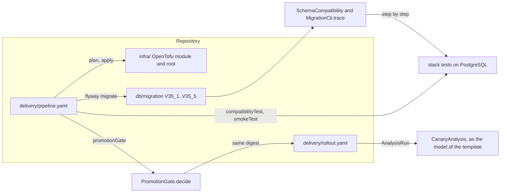

# Architecture of seatwave-delivery

Module 35 of the course "System Design Fundamentals" ships SeatWave's changes: the environment as
OpenTofu code, a pipeline that promotes one image digest, a canary that rolls back by itself, and a
column rename done with expand and contract. This project holds the artifacts of each, the models
that explain them, and a run of the rename on real PostgreSQL.

## Packages

| Package | What it holds | Depends on |
|---|---|---|
| `iac` | `FakeCloud` (a provider API in miniature), `StateBackend` (shared state with a lock), `PlanEngine` (refresh, plan, apply), `IacDemo` and Lab 1 | the JDK, result4j |
| `canary` | `CanaryAnalysis` (the judge: bounds, confidence, minimum sample), `CanaryCli` and Lab 2 | the JDK, result4j |
| `migration` | `SchemaCompatibility` (the rule for every schema step), `MigrationCli` (four plans checked step by step) and Lab 3 in memory | the JDK |
| `promotion` | `PromotionGate` (production runs only the digest staging tested) and `PromotionGateCli`, the command the promote stage runs | the JDK, result4j, Jackson |
| `stack` | the rename on PostgreSQL: `StackSettings`, `LabDatabase` (pools, Flyway, seeding), `ReleaseQueries` (each release's SQL, built from the model's behaviors), `OpenLoad`, `RenameUnderLoadCli`, `MigrationTimingsCli` | `migration`, Flyway, the JDBC driver, HikariCP |

**Dependency rule.** The four model packages depend on nothing but the JDK and result4j (and Jackson
for reading the staging record). Only `stack` touches a database, and it depends on `migration`,
never the other way: the model is the question, the database is asked the same question.

## Data flow

## Walk-throughs

**A promotion.** The promote stage calls `./gradlew promotionGate -Pimage=<repository@digest>
-PstagingRecord=<file>`. `PromotionGateCli` reads the staging record (unknown fields refused, at
most 4 KiB) into `StagingRecord`, whose constructor refuses anything but a sha256 digest;
`PromotionGate.decide` refuses a tag, a digest staging did not test, and a record with a gate
missing, each as its own `PromotionRefusal`. Exit 0 promotes, 1 refuses, 2 is wrong usage.

**A schema step.** `MigrationCli.trace` walks a plan: each Flyway migration changes the modeled
schema (and is refused when its version is not above the highest applied), the backfill fills a
column, a rollout runs the old and new behaviors together, a flag lock retires one. After each
step it records which behaviors were checked, which run afterwards, which a rollback would bring
back, and the problems of each. `ExpandAndContractOnPostgresTest` applies the same steps to
Module 13's `bookings` table and runs each of those behaviors' own confirm and read
(`ReleaseQueries.wouldFail`, inside a transaction that is rolled back), and fails on any step where
the database and the model disagree.

**The rename under load.** `RenameUnderLoadCli` sends 300 requests a second, open loop, to three
modeled pods; each request runs one of its pod's behaviors through `ReleaseQueries`. The step runner
applies the plan's migrations and the backfill while the load goes on and replaces one pod every
25.7 s. Every request is recorded with its outcome; failures are grouped by the database's reason.

## Decisions and trade-offs

- **The models stay, and are checked against the database.** The seed's JDK-only models teach the
  rule in a few hundred lines; the stack test makes them answerable to PostgreSQL, which is how the
  seed's defect (the way back to v1 open after V35_3) was found to matter: the database refuses v1
  there, so the model now does too.
- **Behaviors generate the SQL.** A release's queries are built from its `Behavior` (the columns it
  reads and writes), from an allow-list of two column names. One source for the model and the
  database means the comparison cannot drift; the cost is that a release's SQL is simpler than
  SeatWave's real queries.
- **Open-loop load on virtual threads, bounded.** Requests leave on schedule whatever the database
  does, so a lock shows as long requests rather than as fewer requests; at most 256 are in flight,
  and a request with no room counts as failed and is reported.
- **Flyway reads two folders.** Module 13's migrations are copied unchanged into `db/module-13`, so
  the table under the rename is Module 13's own, constraints and foreign keys included.
- **IacDemo stays a miniature.** It declares 9 to 11 resources of the 36 and 37 the OpenTofu module
  declares; the cache, the brokers, the security group and the IAM policy added to the module are
  not mirrored in it, because the six experiments do not need them.
- **No CI workflow.** `delivery/pipeline.yaml` is a neutral definition; its local tasks
  (`compatibilityTest`, `smokeTest`, `promotionGate`) are run one by one on this machine.

## Invariants and where they are enforced

| Invariant | Enforced by | Tested by |
|---|---|---|
| Production runs only the digest staging tested, named by digest, after every gate | `PromotionGate.decide`; the promote stage's exit status | `DeliveryInvariantTest`, `PromotionGateTest` |
| Every schema step works for every version that can be running | `SchemaCompatibility.problems`; in PostgreSQL, the constraints and `lock_timeout` in each migration | `DeliveryInvariantTest`, `ExpandAndContractOnPostgresTest` |
| A migration is applied in version order only | `MigrationCli.trace`; Flyway's default (outOfOrder off) | `DeliveryInvariantTest`, `OutOfOrderOnPostgresTest` |
| A canary is never promoted on too small a sample, and its bounds come from the stable version's same window | `CanaryAnalysis.judge` | `DeliveryInvariantTest`, `CanaryAnalysisTest` |
| Two applies never write one state at once | `StateBackend.lock`; in OpenTofu, `use_lockfile` | `DeliveryInvariantTest`, `StateBackendTest` |
| Static stability: two compute zones, each able to carry the peak | the node group's `precondition` in OpenTofu; `IacDemo.Environment` | `ProgramOutputTest` (Lab 1's refusal) |
| Database clusters cannot be destroyed by a plan | `prevent_destroy`, `deletion_protection` | not run: needs an account |
